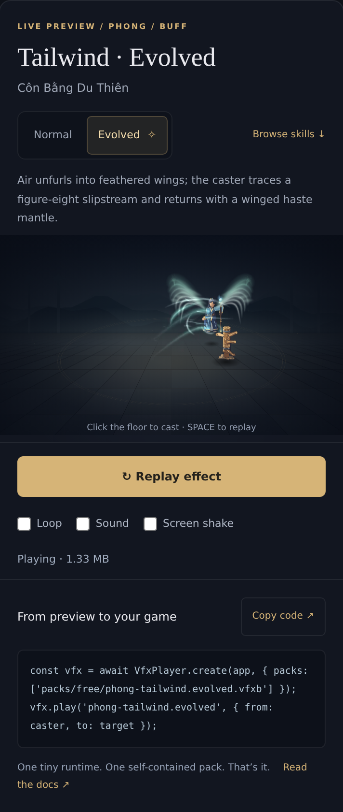

[](https://lenhonbp.github.io/pixijs-skill-vfx/)

# PixiJS Skill VFX

[](https://lenhonbp.github.io/pixijs-skill-vfx/)
[](LICENSE)

**Free runtime. Instant magic.** 25 ready-to-play skills.
A lightweight, zero-runtime-dependency atlas player for **PixiJS v7 and v8**,
with a responsive, interactive showcase. Commercial use welcome.

[Try the live collection →](https://lenhonbp.github.io/pixijs-skill-vfx/) · [Runtime docs](runtime/README.md) · [Pack format](docs/pack-format.md)

## Quick start

```ts
import { VfxPlayer } from '@lenhonbp/pixijs-vfx-runtime';
const vfx = await VfxPlayer.create(app, { packs: ['packs/free/hoa-fireball.vfxb'] });
vfx.play('hoa-fireball', { from: caster, to: target });
```

```sh
npm install @lenhonbp/pixijs-vfx-runtime
```

Get packs from the showcase's **Desktop pack / Mobile pack** buttons, from
`showcase/public/packs/free/`, or with the agent skill's fetch script below, and
serve them from your app's public directory.

## Use it from an AI coding agent

[`skills/lenhon-vfx`](skills/lenhon-vfx/SKILL.md) is an agent skill (Claude Code,
Codex and other `SKILL.md`-compatible agents) that wires the free packs into an
existing PixiJS project: it installs the runtime, downloads the chosen packs and
writes the integration. It plays baked effects only; it does not author new ones.

```sh
npx skills add lenhonbp/pixijs-skill-vfx   # or copy skills/lenhon-vfx into your agent's skills folder
```

Then ask your agent, for example: *"add Lenhon's fireball and chain lightning to
my PixiJS game, played from the hero to the enemy"*. The bundled script also works
on its own:

```sh
node skills/lenhon-vfx/scripts/fetch-packs.mjs --list
node skills/lenhon-vfx/scripts/fetch-packs.mjs hoa-fireball --out public/vfx
```

## Built for your game

- **25 free skills** — fire, ice, lightning, wind, metal, wood, earth and
  utility, each with a desktop and a mobile pack.
- **Actor tracks** — `handle.pose('caster')` / `handle.pose('target')` provide
  interpolated movement, lift, visibility and facing. Dashes and flight move
  the showcase's swordsman, with grounded shadows and hit reactions.
- **Ordered, independently scaled layers** — crisp details and additive glow,
  with per-skill quality presets and selective 60 FPS. Most casts use up to three
  ordered layers; Stone Skin preserves its exact five-layer draw order.
- **Desktop and mobile packs** — the showcase lazy-loads only the selected
  skill, and releases the previous pack.
- **Gameplay feedback** — pooling, cue events, optional screen shake and
  hit-stop. The showcase adds sound hints, looping and a release-synchronized sword cast.
- **Spritesheet demo caster** — a feet-anchored swordsman with a 24-frame,
  680 ms source clip, time-warped to align its 270 ms release with each effect.
  The drawn caster is retained only if the character sheet fails to load.
- **English + Vietnamese** names, searchable collection, shareable skill links,
  copyable integration snippets and per-skill desktop/mobile pack downloads.

Only baked assets are distributed: no procedural authoring factory or baker
implementation is included. The runtime and showcase remain MIT.

<details>
<summary>Mobile showcase</summary>



</details>

## Collection size and loading

The 25 skills ship as **50 desktop/mobile containers**:
57,462,676 bytes desktop + 20,832,436 bytes mobile = **78,295,112 bytes**.
Including the 15,944-byte index, `showcase/public/packs/free/` totals 78,311,056 bytes.
You only need the packs selected for your game; the showcase loads one skill at a time.
18 desktop and 15 mobile packs play at 60 FPS; the rest play at 30 FPS.

Measured on 2026-11-22, the default Fireball cold first load was **2,195,377 bytes
desktop / 1,444,150 bytes mobile**, including the application, character artwork
and HTTP overhead on a local uncompressed server. See
[download sizes and measurement conditions](docs/pack-format.md#current-free-collection-and-download-sizes)
for the full breakdown.

## Premium Skill Packs — coming soon

The runtime stays free; optional art collections will expand your library:

| Collection | Theme | Availability |
|---|---|---|
| **Kiếm Hiệp** | Martial legends, sword auras and flying blades | Coming soon |
| **Ngũ Hành** | Metal, wood, water, fire and earth | Coming soon |
| **Ultimate Boss** | Arena-shaking final encounters | Coming soon |

The showcase catalog distinguishes Free effects from Premium collections and
shows each product's contents, compatibility and release status. Free effects keep
their live previews, all cast directions and downloads. Premium collections get
video previews and itch.io/Gumroad purchase links when released. The current three
collections are coming soon, with no prices or checkout links announced.

See [storefront catalog maintenance](docs/storefront-catalog.md) for product data,
release requirements and the boundary between public previews and paid delivery.

## Run the showcase locally

```sh
npm install
npm run dev:showcase
# Production: npm run build
# Browser smoke (build first): npm run check:runtime
# Types: npm run typecheck
# Catalog: npm run check:catalog
```

GitHub Pages deploys the Vite showcase.

## License

© 2026 lenhonbp <lenhonbp@gmail.com> · [MIT license](LICENSE).
The runtime and showcase are MIT licensed. Keep the copyright and license notice when redistributing runtime code.
Character artwork (c) 2026 lenhonbp; excluded from the MIT licence.
