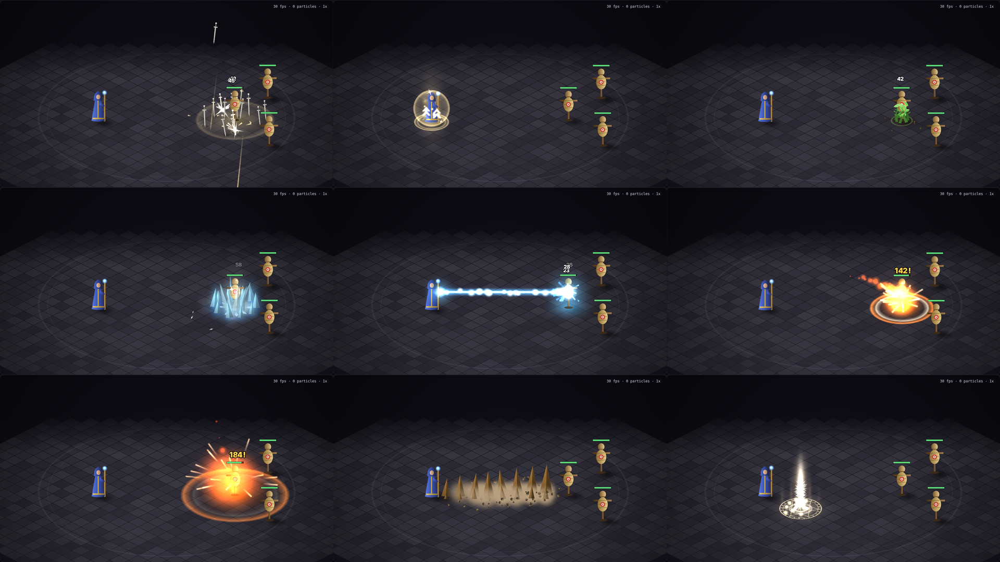

# pixijs-skill-vfx

[Live VFX showcase](https://lenhonbp.github.io/pixijs-skill-vfx/) · [Runtime docs](runtime/README.md) · [Pack format](docs/pack-format.md)

## Free runtime. Instant magic.

**Runtime is free forever (MIT)** — a zero-runtime-dependency atlas player for
PixiJS v7 and v8, with 25 free baked effects, English/Vietnamese names, additive
glow, pooling, cue events, optional shake and hit-stop. Commercial games welcome.
The [interactive showcase](showcase/) lets you filter, cast, replay and loop the
collection, try synthesized sound hints, and copy integration code.

```ts
import { VfxPlayer } from '@lenhon/pixijs-vfx-runtime';
const vfx = await VfxPlayer.create(app, { packs: ['packs/free/hoa-fireball.vfxb'] });
vfx.play('hoa-fireball', { from: caster, to: target });
```

The 1.0.0 runtime package is prepared for publishing; see [local installation](runtime/README.md#install)
until the npm release is available. Baked packs live in `showcase/public/packs/free/`.
Only baked assets are distributed: no offline factory or baker code is included.

### Premium Skill Packs — coming soon

The runtime stays free; optional art collections will expand your library:

| Collection | Theme | Stores (placeholder links; coming soon) |
|---|---|---|
| **Kiếm Hiệp** | Martial legends, sword auras and flying blades | [Gumroad](#gumroad-link-tbd) · [itch.io](#itch-link-tbd) |
| **Ngũ Hành** | Metal, wood, water, fire and earth | [Gumroad](#gumroad-link-tbd) · [itch.io](#itch-link-tbd) |
| **Ultimate Boss** | Arena-shaking final encounters | [Gumroad](#gumroad-link-tbd) · [itch.io](#itch-link-tbd) |

### Run the showcase locally

```sh
npm install
npm run dev:showcase
# Production: npm run build:runtime && npm run build:showcase
# Browser smoke (build first): npm run check:runtime
```

GitHub Pages now deploys the Vite showcase. The original procedural kit and its
documentation remain below for compatibility; they are independent of the new runtime.

---

## Original agent skill & procedural kit

An agent skill (Claude Code, Codex) plus a tested TypeScript kit for **code-drawn 2.5D skill VFX
in PixiJS v7 and v8**. No art assets: textures are generated with Canvas 2D. The shared set is baked at startup;
specialized material sets are cached on first use.



- **Coverage**: attacks and impacts, AoE telegraphs, projectiles, beams, cone breath, chain
  lightning, meteors, heals, shields that break, buffs/debuffs, poison/burn/bleed with tick
  numbers, stun/freeze/slow/root, dash/blink/leap, summon circles, floating damage numbers,
  tornadoes, wind blades, pressure fronts and ribbon-trailing wind steps.
- **Five elements (Ngũ Hành / Wu Xing) + Phong (wind) and Lôi (lightning)**: Kim, Mộc, Thủy, Hỏa,
  Thổ and two variants, each with its own palette, shapes and motion, and 29 complete sample skills in
  `examples/skills.ts`.
- **Extend it for your game**: register custom elements, recolor palettes and compose skills with
  the [extension guide and status catalog](references/extending.md).
- **Modern techniques on stock Pixi**: mesh ribbon trails, curl-noise motion, screen-space
  distortion (shockwave refraction, heat haze) and bloom, with quality tiers for phones.
- **2.5D-correct**: ground plane + height, depth sorting, ground-aligned decals, and a Blender
  rig (`tools/blender_vfx_rig.py`) so effects match pre-rendered 3D sprites.
- **Production-minded**: pooled sprites, particle cap, hit-stop, screen shake, handles that clean
  up; every sample skill returns to 0 live particles on v7 and v8.

## Install

Keep the folder name `pixijs-skill-vfx` (it must match `name` in `SKILL.md`).

Claude Code plugin install:

```text
/plugin marketplace add lenhonbp/pixijs-skill-vfx
/plugin install pixijs-skill-vfx@pixijs-skill-vfx
```

The plugin manifest explicitly loads `./` as its skill directory: `SKILL.md` stays at
the repository root, with the kit and references alongside it.

- **Claude Code**: copy the folder to `<your-game-repo>/.claude/skills/pixijs-skill-vfx/`
  (project) or `~/.claude/skills/pixijs-skill-vfx/` (all projects). Claude loads it when you ask
  for skill effects; you can also say "use the pixijs-skill-vfx skill".
- **Codex**: copy it to `<your-game-repo>/.agents/skills/pixijs-skill-vfx/` (project) or
  `~/.agents/skills/pixijs-skill-vfx/` (user; older Codex versions read `~/.codex/skills/`). Restart Codex; then ask for the effect or
  invoke it with `$pixijs-skill-vfx`. If your Codex version has no skills support, add this
  line to your repo's `AGENTS.md`: `For any skill/ability VFX work, first read and follow .agents/skills/pixijs-skill-vfx/SKILL.md.`

## Try the demo

The original demo is built locally with PixiJS 8. GitHub Pages deploys the new atlas showcase on every push to `main`.

```sh
npm install
npm run build                 # bundles demo/demo.js
npx serve demo                # or any static server, then open it in a browser
```

Pick a skill from the list (or its displayed keyboard shortcut; tap the arena on phones), filter by element, replay with Space, slow down
to 0.5x/0.25x, switch quality and toggle bloom/distortion, or press Showcase to cycle all skills. `#showcase` in the URL starts it directly.
Works with pixi.js 7.4+ too: `npm i pixi.js@7` and rebuild.

## Development and verification

| Command | Purpose |
|---|---|
| `npm run dev` | Watch, rebuild and serve the demo |
| `npm run typecheck` | Validate the kit, runtime and showcase |
| `npm run build` | Bundle the original demo, runtime ESM/declarations and Vite showcase |
| `npm run check:runtime` | Built-showcase lifecycle/pool smoke, plain/container format, Pixi v7 compatibility |
| `npm run capture` | Build/serve and capture deterministic contact sheets |
| `npm run check` | Browser lifecycle, pool, particle-budget and runtime contracts; build first |
| `npm run check:docs` | Node-only export-index, file-map and sample-count gate |

After `npm install`, install Chromium once with `npx playwright install chromium`.
Run `npm run capture -- --skills thuy-tidal-beam,kim-sword-rain --out ~/audit/after/`
to build and serve the demo, then capture seeded, deterministically stepped frames.
Use comma-separated skill IDs (`--skills a,b`); omit `--skills` to capture all skills.
Each output directory contains labeled PNG contact sheets and `counts-tierN.json`
with `--tier N` (otherwise `counts.json`), with live particle counts at each skill's
length + tier pre-roll + 1900 ms. The default output is `~/audit/before/`;
`--seed INTEGER` overrides the default seed of 12345.

See [verification and reproducibility](references/extending.md#verification-and-reproducibility)
for setup, capture flags, tier-less versus tiered captures, exact checkpoints, RNG,
particle baselines and focused regression tests. Inspect captures as well as counts.

### Evolved casts

Use `skillActivation(w, tex, { at, height, palette, element, tier })`, then start
gameplay after `activationRelease(tier)` (0/250/400 ms). `empoweredAura` takes the
same caster options plus `duration` (or `Infinity, idle: true`, keeping its stoppable
handle). Activation, cast and idle share an element-specific motif: blades,
vine/leaves, orbiting droplets/ripple, low flame wisps/embers, low rocks, wind spirals or
lightning arcs. Tier 2 is lighter; tier 3 is stronger. Utility uses its own supplied
palette's orbiting inscribed talismans and grounded halo, not a default purple. Earth adds a dust-coloured
ring; lightning continuously crackles around feet/legs above a violet ring.
No evolved shared rune/body glow; floor pieces remain at z=0. `skillEvolution`
adds `fromTier`/`toTier`: gather → transform → stamp uses converging blades,
blooming vines, a freezing water spiral, flame vortex, rising/slamming rocks,
cyclone or lightning cage/strike. Utility gathers four talismans, folds them into
an overhead emblem, then stamps the halo and resting talismans. Water gathers
three broad incoming streams with droplets before freezing into its crest.
Water, fire and utility keep two/three orbiting objects at tiers 2/3 during
stamp, idle and casts; water/utility use four sprites at tier 3, fire five.
Objects orbit low and wide behind the caster, never in a column over the body.
The destination motif appears at 950 ms; evolution finishes at 1600 ms.

Pass `empoweredWorld(w, { tier, palette, textures: tex })` to native skill code:
only recognized additive energy grows/brightens (1.2x/1.45x), including private fire
flames, water foam and wood light shafts/halos. `VfxWorld.energyScale` is read-only
(1 normally; 1.2/1.45 through the facade); lightning uses it to widen channels and
halos without changing endpoints, opacity or violet colour. Additive ribbons widen without
moving their centerline/endpoints. Density, tint, authored materials and particle
trail proportions remain unchanged. Always retain
native hit feedback at every tier; layer `empoweredHit(w, tex, { at, palette, tier,
element, tick? })` behind the target for capped, throttled elemental accents, not
generic ground ellipses. Tier 1 is unchanged. See [recipes](references/recipes.md).
Fissure keeps its native glint and eight sparks but opts out of the bleaching body
glow with `hitSpark`'s `coreAlpha: 0`; a warm palette and smaller sparks preserve wood detail.
The evolved demo re-triggers rapid native bursts with `hitSpark`'s optional
`refresh: true`, retaining all sparks on every hit without accumulating overlapping
bursts. `damageNumber`'s optional `compact: true` bakes all glyphs into one temporary
sprite (disposed on completion/clear), preserving crit styling and lifetime;
neither option changes defaults or tier 1.


## Utility samples

The 29 samples include six neutral Utility skills (all use the ordinary 150-particle
budget, including awakened casts):

| ID | Skill | Choreography |
|---|---|---|
| `seal-silence` | Silencing Seal | Hand sigil, chain-tailed rune projectile, tightening body chains and dissolving overhead seal |
| `sunder-mark` | Sundering Mark | Orange reticle charge, staggered target locks, armor fractures and crumbling shield emblems |
| `war-cry` | War Cry | Braced inward breath, three roar arcs, local ground refraction and a clean ember aura |
| `shadow-blink` | Shadow Step | Violet-rimmed dark smoke, low ground passage, afterimages and a crisp crossed slash |
| `curse-weaken` | Curse of Frailty | Sickly violet-green hex, staggered rising bindings, downward pulses, draining motes and skull glyphs |
| `summon-spirit` | Summon Guardian | Swept gold rune, bottom-up reveal, floating halberd combo and upward dissolve |

These recipes and their named option types are available from `kit/index.ts`.
`SkillTiming` includes status contacts as `effectOnly` entries (not extra damage).
See the [recipe catalog](references/recipes.md#utility-composition-and-timing) for timings
and reuse; guardian reveal, strikes and dissolve extend through about 5400 ms.


The iteration/choreography approach is inspired by
[pixelfx](https://github.com/patch-gg/pixelfx) and Hugo Duprez's VFX method;
no renderer or effect implementation is ported.

## Layout

| Path | What it is |
|---|---|
| `SKILL.md` | Instructions the agent follows |
| `.claude-plugin/` | Marketplace and plugin manifests; root skill registration |
| `kit/index.ts` | Public entry point; every export is listed in [references/api.md](references/api.md) |
| `kit/` | Runtime, specialized recipes and texture/material modules; [complete file map](SKILL.md#runtime) |
| `examples/skills.ts` | 29 sample skills over a small `SkillContext` |
| `references/api.md` | Canonical public-API index and direct-module import boundaries |
| `references/recipes.md` | Recipe options, textures, floor rings and activation contract |
| `references/extending.md` | Custom elements, recoloring, timing, reactions, status catalog and verification |
| `references/elements.md` | Seven built-in element design languages and sample families |
| `references/advanced-fx.md` | Ribbons, noise, distortion, bloom and quality tiers |
| `references/blender-2-5d.md`, `references/pixi-v7-v8.md` | Blender projection and compatibility |
| `tools/` | Check/capture scripts, baseline, focused regressions and Blender rig; [complete tool map](SKILL.md#tools) |
| `demo/main.ts`, `demo/index.html`, `demo/preview.png` | Showcase source, controls and preview; generated bundle is `demo/demo.js` |
| `package.json`, `tsconfig.json` | Commands/dependencies and TypeScript configuration |
| `.github/workflows/` | CI validation and Pages deployment |
| `LICENSE` | MIT license |

## Example prompts

Activation tiers (**Cơ bản → Thức tỉnh → Tiến hoá**) add live-following elemental
seals, wisps and ascension bursts. Use the demo tier selector and **Evolve** button;
`skillActivation` and `skillEvolution` work with any palette, including neutral.
See the [activation contract](references/recipes.md#activation-and-evolution) for scheduling
and return values.

- "Use pixijs-skill-vfx to add a frost slash for the warrior's skill 2, hit on frame 3 of the attack animation."
- "Make the boss's ground slam: 600 ms red telegraph, then a shockwave and debris, damage on impact."
- "Port our fireball VFX onto the kit and keep it under 120 particles."
- "Make a Thổ (earth) ultimate in the style of Mountain Crash but with a 3-hit combo."
- "Our stun icon is a static sprite; replace it with the kit's stun stars and a freeze variant for ice skills."

## Author & license

Made by [lenhonbp](https://github.com/lenhonbp) ([lenhonbp@gmail.com](mailto:lenhonbp@gmail.com)).
Licensed under [MIT](LICENSE): free to use, modify, and ship, including commercially.
Keep the copyright and license notice when redistributing the code.
Credit or a link back is appreciated, but optional for products.
