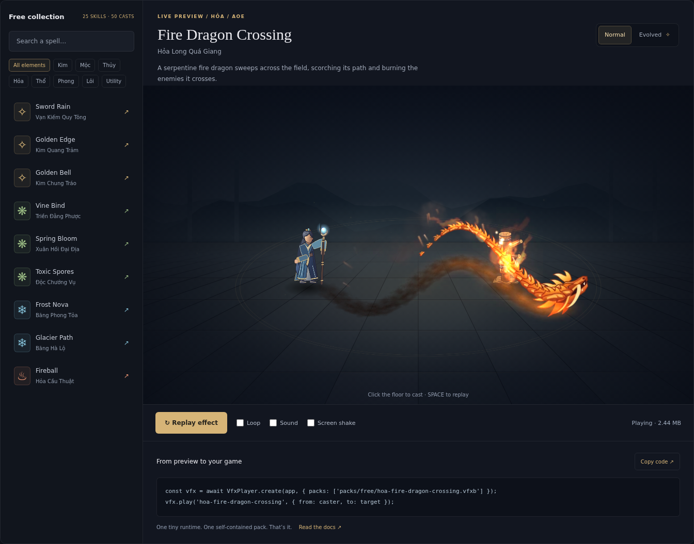

[](https://lenhonbp.github.io/pixijs-skill-vfx/)

# PixiJS Skill VFX

[](https://lenhonbp.github.io/pixijs-skill-vfx/)
[](LICENSE)

**Free runtime. Instant magic.** 25 skills, 50 Normal and Evolved casts.
A lightweight, zero-runtime-dependency atlas player for **PixiJS v7 and v8**,
with a responsive, interactive showcase. Commercial use welcome.

[Try the live collection →](https://lenhonbp.github.io/pixijs-skill-vfx/) · [Runtime docs](runtime/README.md) · [Pack format](docs/pack-format.md)

## Quick start

```ts
import { VfxPlayer } from '@lenhon/pixijs-vfx-runtime';
const vfx = await VfxPlayer.create(app, { packs: ['packs/free/hoa-fireball.vfxb'] });
vfx.play('hoa-fireball', { from: caster, to: target });
```

The runtime package is prepared for publishing; use [local installation](runtime/README.md#install)
until the npm release is available. Copy the packs you need from
`showcase/public/packs/free/` to your app's public directory.

## Built for your game

- **25 free skills with Evolved tiers** — fire, ice, lightning, wind, metal,
  wood, earth and utility. Switch tiers in the showcase or load
  `<id>.evolved.vfxb` directly.
- **Actor tracks** — `handle.pose('caster')` / `handle.pose('target')` provide
  interpolated movement, lift, visibility and facing. Dashes and flight move
  the showcase's articulated caster, with grounded shadows and hit reactions.
- **Ordered, independently scaled layers** — crisp details and additive glow,
  with per-skill quality presets and selective 60 FPS.
- **Desktop and mobile packs** — the showcase lazy-loads only the selected
  skill and tier, and releases the previous pack.
- **Gameplay feedback** — pooling, cue events, optional screen shake and
  hit-stop. The showcase adds sound hints, looping and category-specific poses.
- **English + Vietnamese** names, searchable collection, shareable tier links,
  and copyable integration snippets.

Only baked assets are distributed: no procedural authoring factory or baker
implementation is included. The runtime and showcase remain MIT.

<details>
<summary>Mobile showcase</summary>


</details>

## Premium Skill Packs — coming soon

The runtime stays free; optional art collections will expand your library:

| Collection | Theme | Stores (placeholder links; coming soon) |
|---|---|---|
| **Kiếm Hiệp** | Martial legends, sword auras and flying blades | [Gumroad](#gumroad-link-tbd) · [itch.io](#itch-link-tbd) |
| **Ngũ Hành** | Metal, wood, water, fire and earth | [Gumroad](#gumroad-link-tbd) · [itch.io](#itch-link-tbd) |
| **Ultimate Boss** | Arena-shaking final encounters | [Gumroad](#gumroad-link-tbd) · [itch.io](#itch-link-tbd) |

## Run the showcase locally

```sh
npm install
npm run dev:showcase
# Production: npm run build
# Browser smoke (build first): npm run check:runtime
# Types: npm run typecheck
```

GitHub Pages deploys the Vite showcase.

## License

© 2026 lenhonbp <lenhonbp@gmail.com> · [MIT license](LICENSE).
The runtime and showcase are MIT licensed. Keep the copyright and license notice when redistributing runtime code.
