# Visual previews (November 2026)

Rendered from the desktop-preset bakes of the private factory repo. Dark solid backgrounds; each label shows skill, frame time in ms and aim angle.

- **PR #34 fixes** (golden-edge aim, lightning-chain target flash, golden-bell projectile, seal-silence floor seam): before = factory `main` cd12ac2, after = PR #34 head 81c2e2f.
- **hoa-dragon-breath ground blob diagnosis**: ground dissolve on vs off. Cause: the ground dissolve filter adds a fixed orange rim (`0xff8a2a` × 1.5) to the additive ground glow layer during the dissolve window.

## sheet_all-four-fixes.png

**Skill:** All four PR #34 fixes · **Frame time:** see panels · **Aim:** see panels

Contact sheet combining the golden-edge, lightning-chain, golden-bell and seal-silence before/after panels.

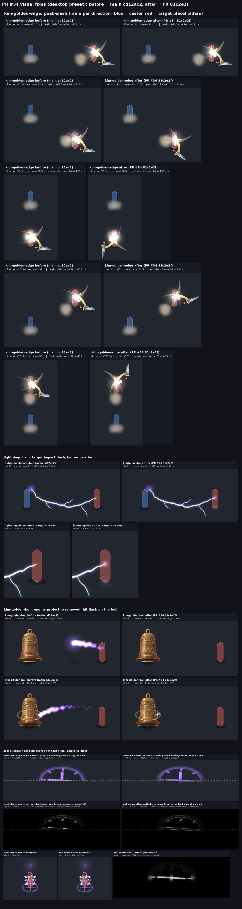

## sheet_dragon-breath_dissolve.png

**Skill:** hoa-dragon-breath · **Frame time:** 2017 ms (frame 121) / 3117 ms (frame 187) · **Aim:** 0°

Diagnosis sheet: ground dissolve on vs off, full and ground-only.

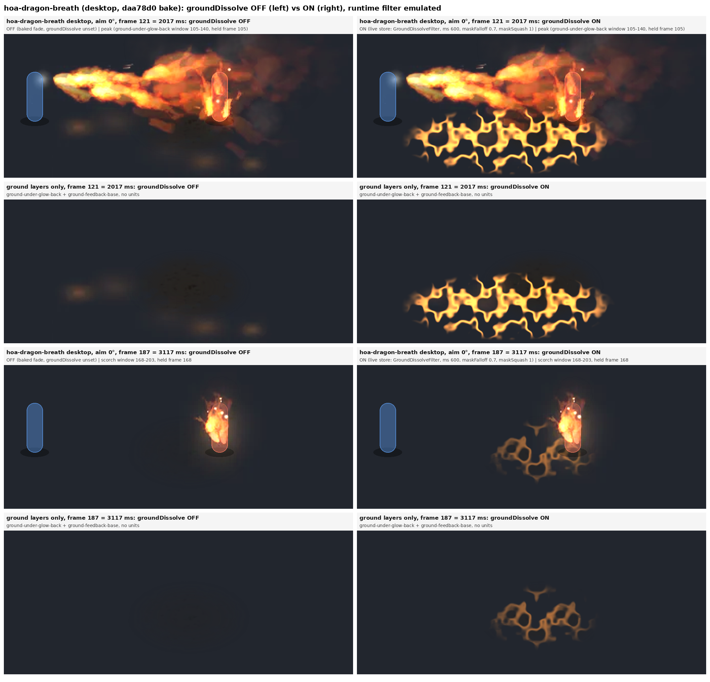

## sheet_kim-golden-bell.png

**Skill:** kim-golden-bell · **Frame time:** 900 ms / 1150 ms · **Aim:** 0°

Projectile and hit frames, before vs after: enemy projectile removed, hit flash on the bell.

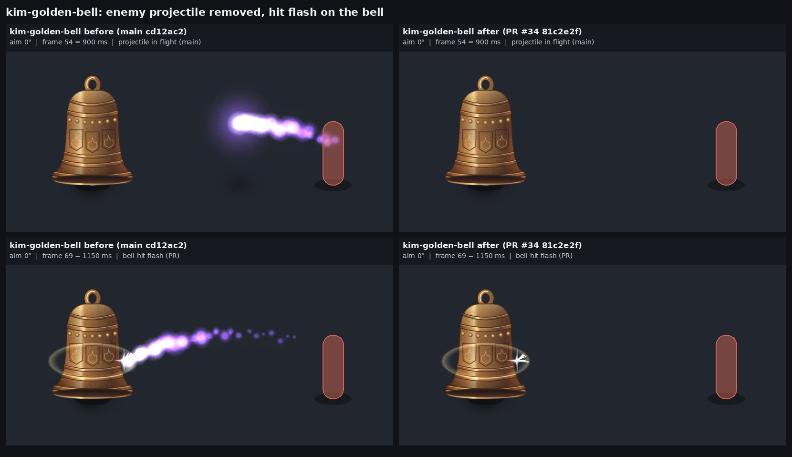

## sheet_kim-golden-edge.png

**Skill:** kim-golden-edge · **Frame time:** 433 ms (frame 26) · **Aim:** 0°, 45°, 90°, -45°, -90°

Peak-slash frame per direction, before vs after: the slash now follows the aim direction.

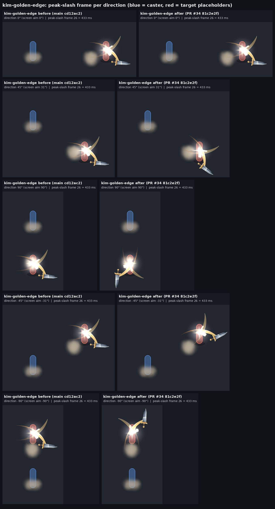

## sheet_lightning-chain.png

**Skill:** lightning-chain · **Frame time:** 350 ms (frame 21) · **Aim:** 0°

Impact frame and target close-up, before vs after: target flash fixed.

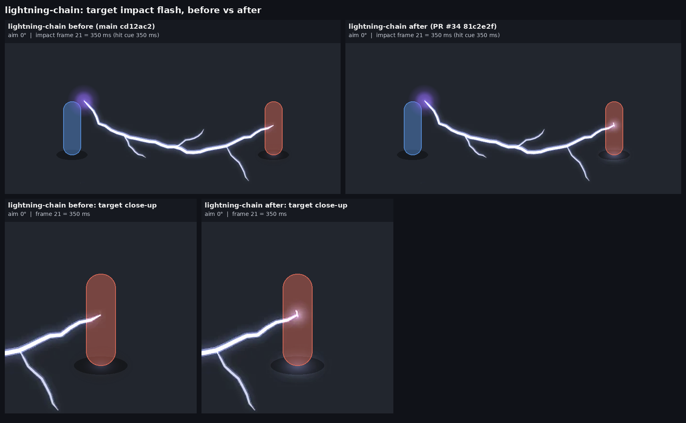

## sheet_seal-silence.png

**Skill:** seal-silence · **Frame time:** 3017 ms (frame 181) · **Aim:** 0°

Floor-ring seam at the feet line, before vs after: the hard seam is gone.

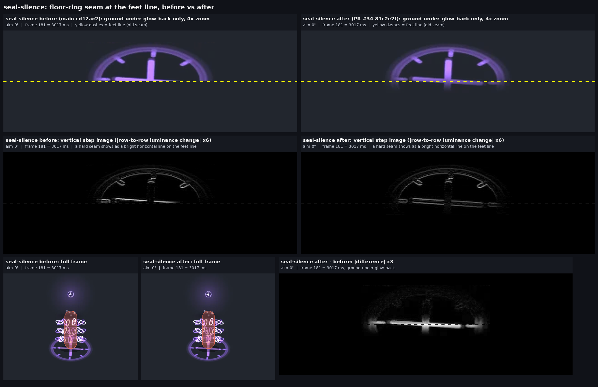

## dragon-breath_f121_dissolve-off.png

**Skill:** hoa-dragon-breath · **Frame time:** 2017 ms (frame 121) · **Aim:** 0°

all layers, ground dissolve off.

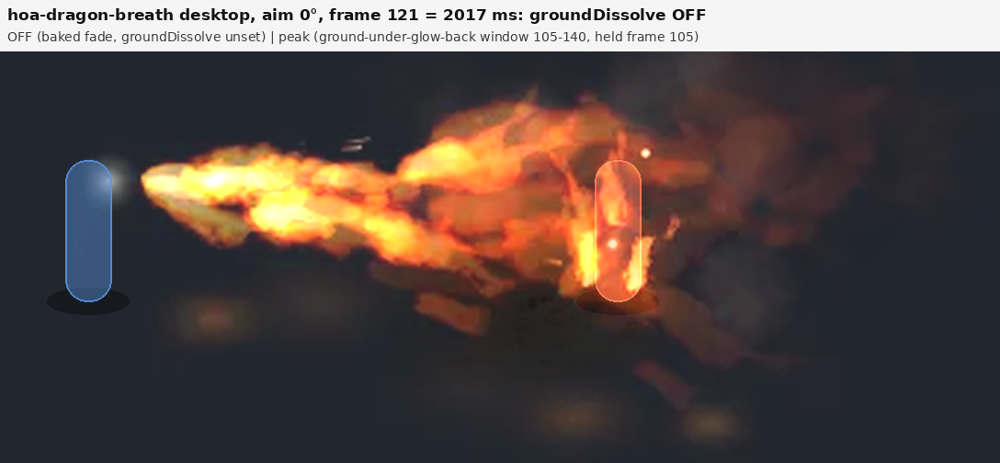

## dragon-breath_f121_dissolve-on.png

**Skill:** hoa-dragon-breath · **Frame time:** 2017 ms (frame 121) · **Aim:** 0°

all layers, ground dissolve on.

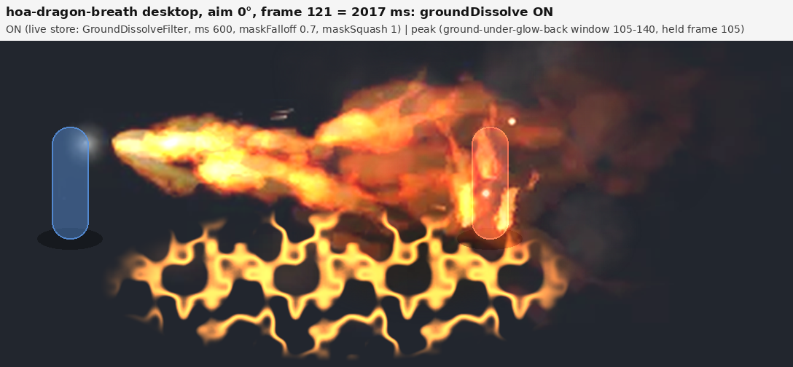

## dragon-breath_f121_ground-only_dissolve-off.png

**Skill:** hoa-dragon-breath · **Frame time:** 2017 ms (frame 121) · **Aim:** 0°

ground layers only, ground dissolve off.

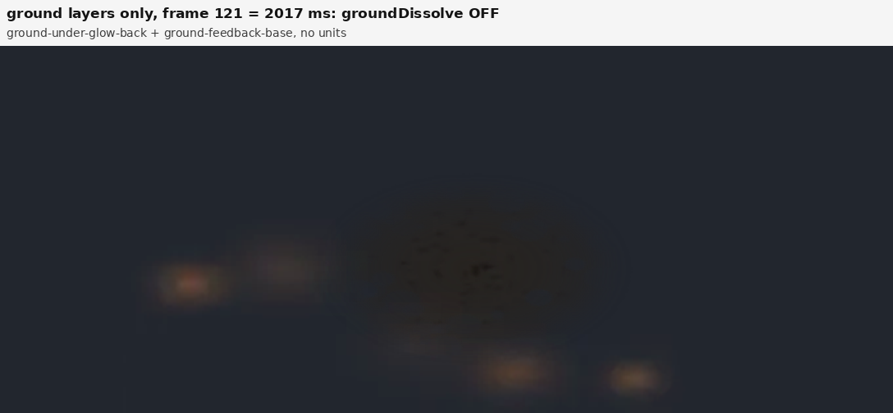

## dragon-breath_f121_ground-only_dissolve-on.png

**Skill:** hoa-dragon-breath · **Frame time:** 2017 ms (frame 121) · **Aim:** 0°

ground layers only, ground dissolve on.

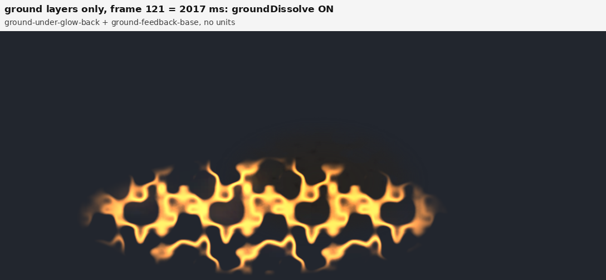

## dragon-breath_f187_dissolve-off.png

**Skill:** hoa-dragon-breath · **Frame time:** 3117 ms (frame 187) · **Aim:** 0°

all layers, ground dissolve off.

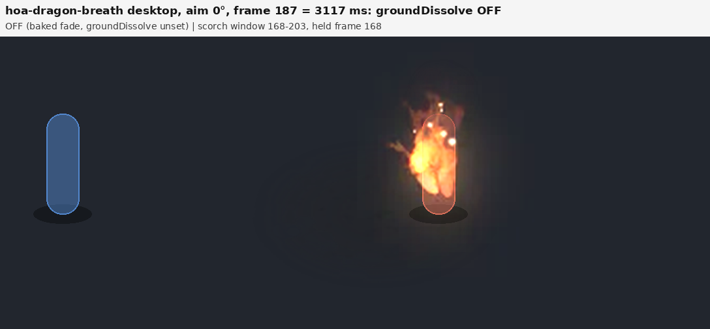

## dragon-breath_f187_dissolve-on.png

**Skill:** hoa-dragon-breath · **Frame time:** 3117 ms (frame 187) · **Aim:** 0°

all layers, ground dissolve on.

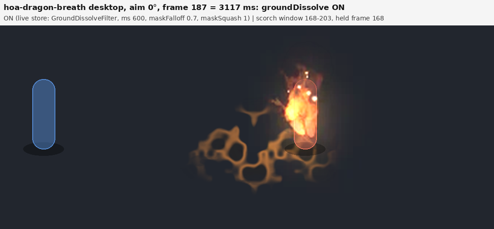

## dragon-breath_f187_ground-only_dissolve-off.png

**Skill:** hoa-dragon-breath · **Frame time:** 3117 ms (frame 187) · **Aim:** 0°

ground layers only, ground dissolve off.

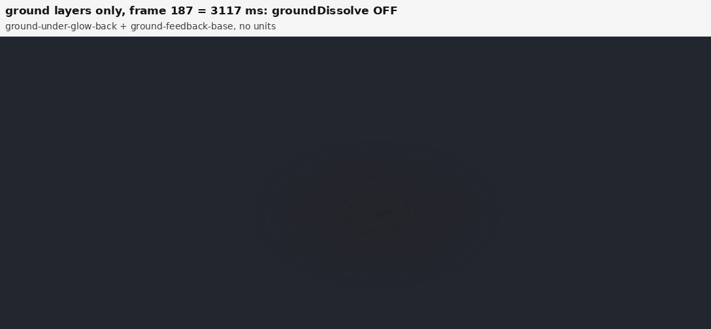

## dragon-breath_f187_ground-only_dissolve-on.png

**Skill:** hoa-dragon-breath · **Frame time:** 3117 ms (frame 187) · **Aim:** 0°

ground layers only, ground dissolve on.

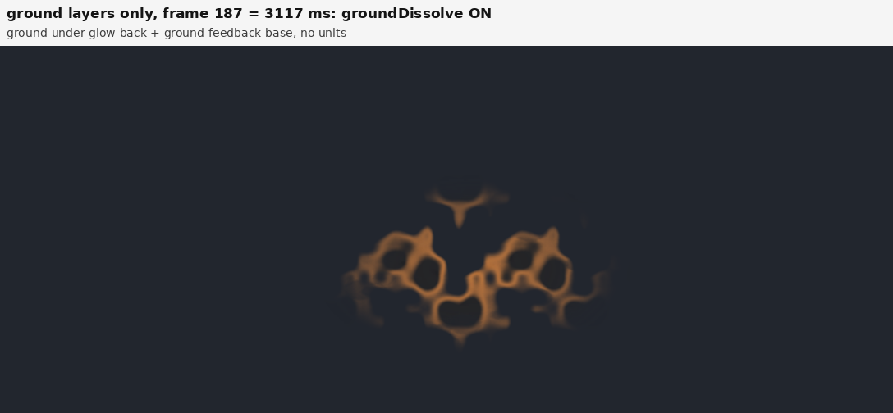

## dragon-breath_runtime_2017ms_dissolve-off.png

**Skill:** hoa-dragon-breath · **Frame time:** 2017 ms (frame 121) · **Aim:** 0°

main bake rendered by the real runtime player, ground dissolve off. No orange blob.

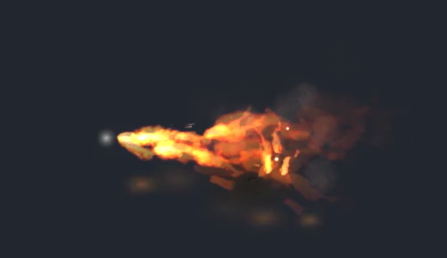

## dragon-breath_runtime_2017ms_dissolve-on.png

**Skill:** hoa-dragon-breath · **Frame time:** 2017 ms (frame 121) · **Aim:** 0°

main bake rendered by the real runtime player, ground dissolve on. Orange elliptical lattice = GroundDissolveFilter rim (cause d).

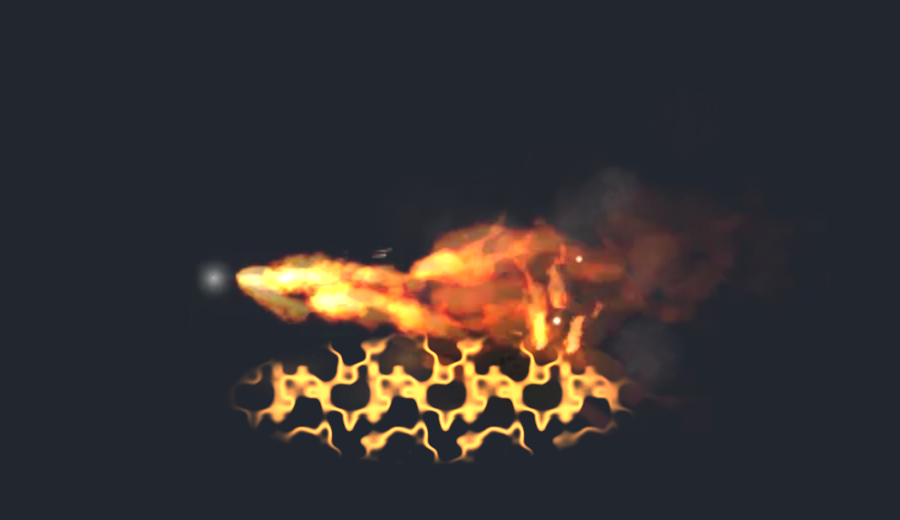

## golden-bell_after_hit-frame.png

**Skill:** kim-golden-bell · **Frame time:** 1150 ms (frame 69) · **Aim:** 0°

after (PR #34 81c2e2f): hit frame; enemy projectile removed, flash on the bell.

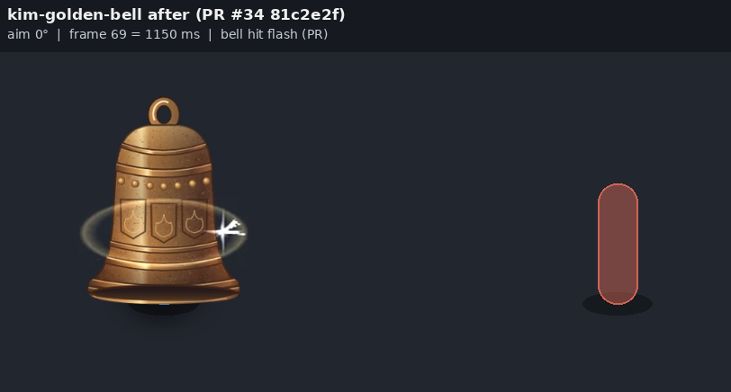

## golden-bell_after_projectile-frame.png

**Skill:** kim-golden-bell · **Frame time:** 900 ms (frame 54) · **Aim:** 0°

after (PR #34 81c2e2f): projectile frame; enemy projectile removed, flash on the bell.

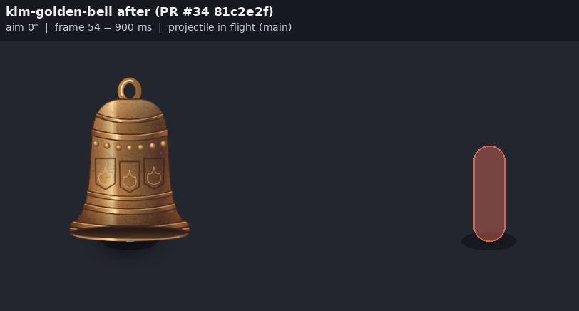

## golden-bell_before_hit-frame.png

**Skill:** kim-golden-bell · **Frame time:** 1150 ms (frame 69) · **Aim:** 0°

before (main cd12ac2): hit frame.

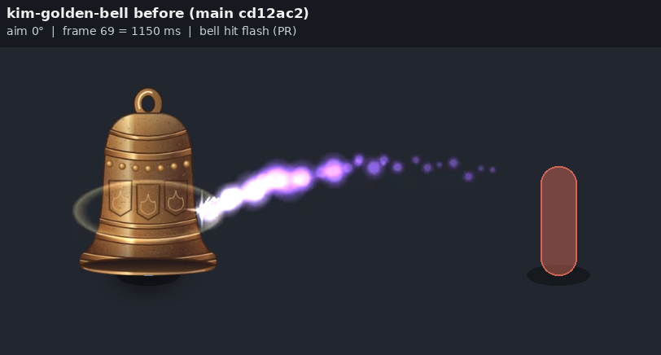

## golden-bell_before_projectile-frame.png

**Skill:** kim-golden-bell · **Frame time:** 900 ms (frame 54) · **Aim:** 0°

before (main cd12ac2): projectile frame.

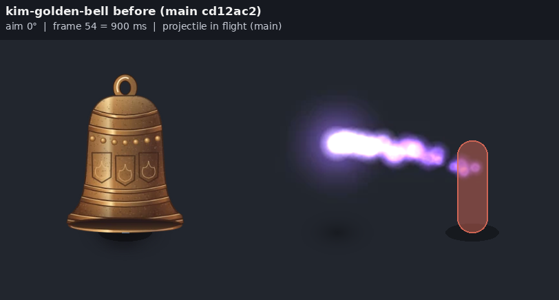

## golden-edge_after_dir-45.png

**Skill:** kim-golden-edge · **Frame time:** 433 ms (frame 26) · **Aim:** -45° (screen -31°)

after (PR #34 81c2e2f): peak-slash frame; slash aligned with the aim direction.

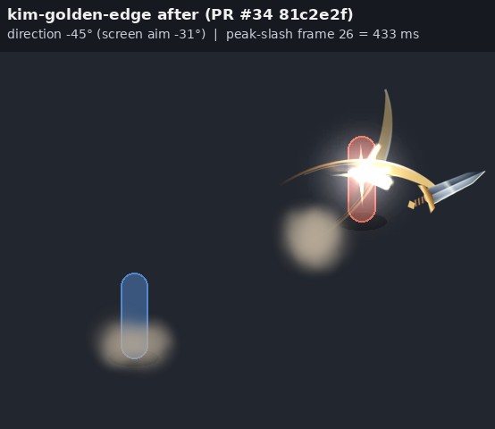

## golden-edge_after_dir-90.png

**Skill:** kim-golden-edge · **Frame time:** 433 ms (frame 26) · **Aim:** -90°

after (PR #34 81c2e2f): peak-slash frame; slash aligned with the aim direction.

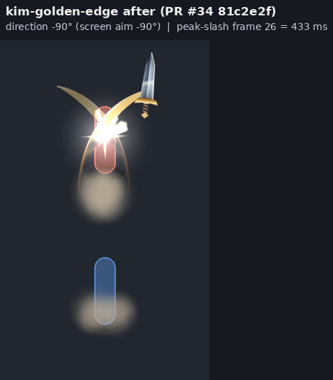

## golden-edge_after_dir0.png

**Skill:** kim-golden-edge · **Frame time:** 433 ms (frame 26) · **Aim:** 0°

after (PR #34 81c2e2f): peak-slash frame; slash aligned with the aim direction.

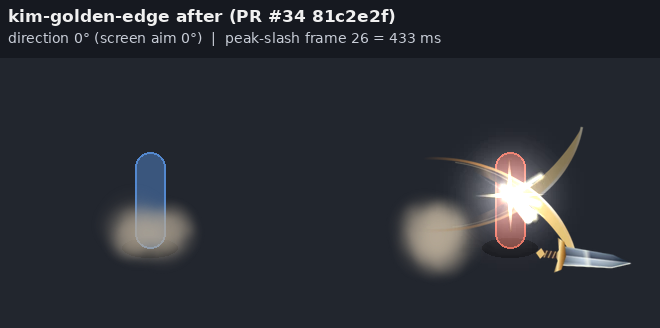

## golden-edge_after_dir45.png

**Skill:** kim-golden-edge · **Frame time:** 433 ms (frame 26) · **Aim:** 45° (screen 31°)

after (PR #34 81c2e2f): peak-slash frame; slash aligned with the aim direction.

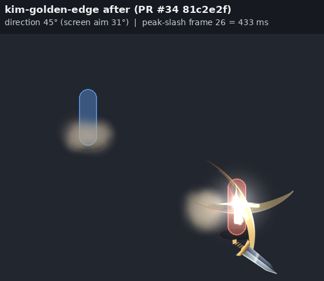

## golden-edge_after_dir90.png

**Skill:** kim-golden-edge · **Frame time:** 433 ms (frame 26) · **Aim:** 90°

after (PR #34 81c2e2f): peak-slash frame; slash aligned with the aim direction.

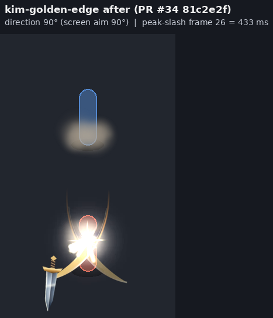

## golden-edge_before_dir-45.png

**Skill:** kim-golden-edge · **Frame time:** 433 ms (frame 26) · **Aim:** -45° (screen -31°)

before (main cd12ac2): peak-slash frame; slash not following aim.

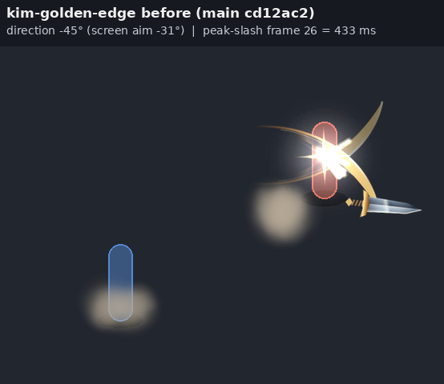

## golden-edge_before_dir-90.png

**Skill:** kim-golden-edge · **Frame time:** 433 ms (frame 26) · **Aim:** -90°

before (main cd12ac2): peak-slash frame; slash not following aim.

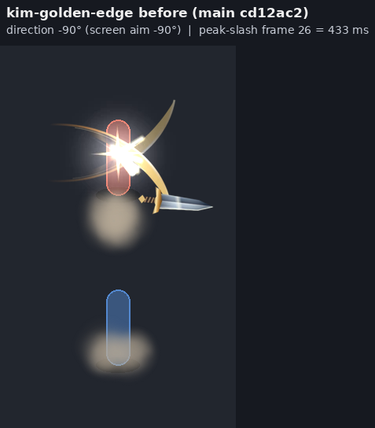

## golden-edge_before_dir0.png

**Skill:** kim-golden-edge · **Frame time:** 433 ms (frame 26) · **Aim:** 0°

before (main cd12ac2): peak-slash frame; slash not following aim.

## golden-edge_before_dir45.png

**Skill:** kim-golden-edge · **Frame time:** 433 ms (frame 26) · **Aim:** 45° (screen 31°)

before (main cd12ac2): peak-slash frame; slash not following aim.

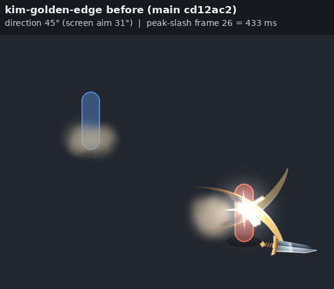

## golden-edge_before_dir90.png

**Skill:** kim-golden-edge · **Frame time:** 433 ms (frame 26) · **Aim:** 90°

before (main cd12ac2): peak-slash frame; slash not following aim.

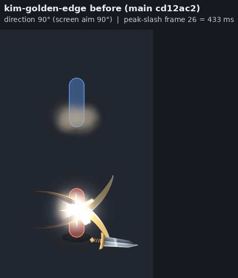

## lightning-chain_after.png

**Skill:** lightning-chain · **Frame time:** 350 ms (frame 21) · **Aim:** 0°

after (PR #34 81c2e2f): impact frame; target flash fixed.

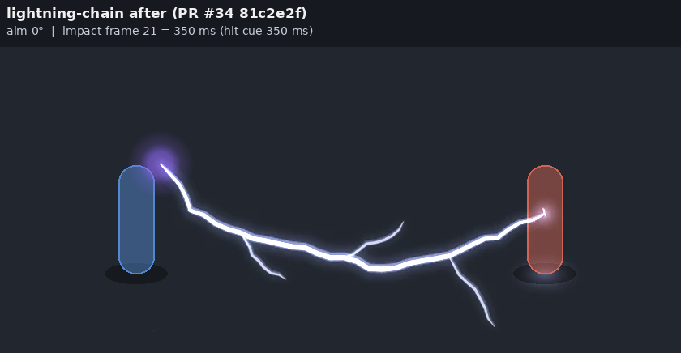

## lightning-chain_after_target-zoom.png

**Skill:** lightning-chain · **Frame time:** 350 ms (frame 21) · **Aim:** 0°

after (PR #34 81c2e2f): target close-up; target flash fixed.

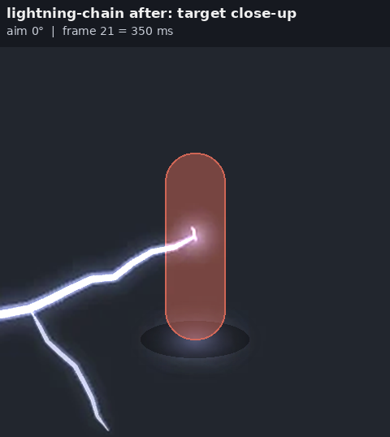

## lightning-chain_before.png

**Skill:** lightning-chain · **Frame time:** 350 ms (frame 21) · **Aim:** 0°

before (main cd12ac2): impact frame.

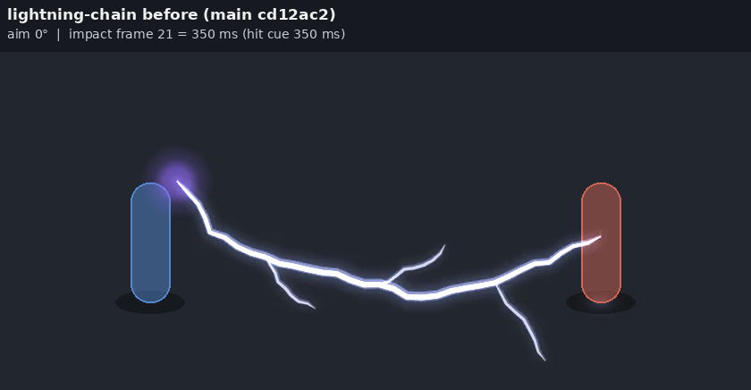

## lightning-chain_before_target-zoom.png

**Skill:** lightning-chain · **Frame time:** 350 ms (frame 21) · **Aim:** 0°

before (main cd12ac2): target close-up.

## seal-silence_after-minus-before.png

**Skill:** seal-silence · **Frame time:** 3017 ms (frame 181) · **Aim:** 0°

|after − before| ×3 of the ground-under-glow-back layer.

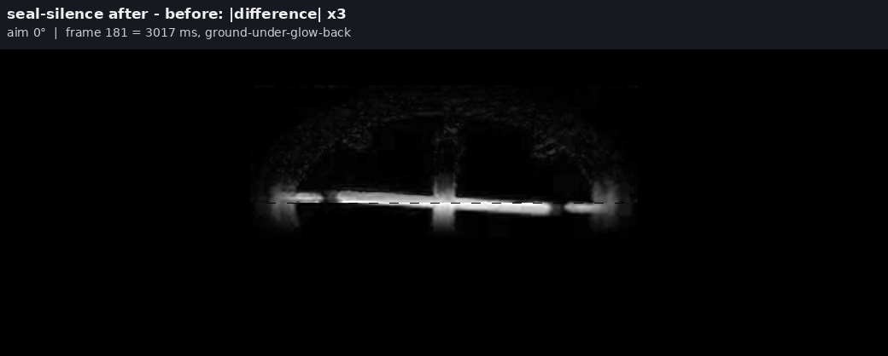

## seal-silence_after_all-layers-zoom.png

**Skill:** seal-silence · **Frame time:** 3017 ms (frame 181) · **Aim:** 0°

after (PR #34 81c2e2f): all layers composited, 4x zoom; seam removed.

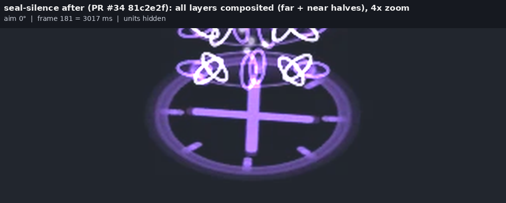

## seal-silence_after_full.png

**Skill:** seal-silence · **Frame time:** 3017 ms (frame 181) · **Aim:** 0°

after (PR #34 81c2e2f): full frame; seam removed.

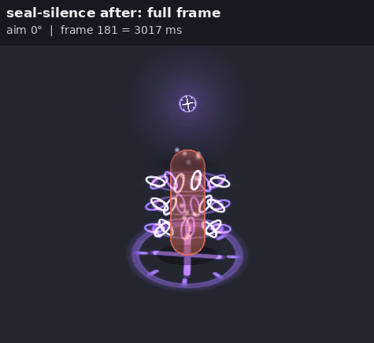

## seal-silence_after_row-step.png

**Skill:** seal-silence · **Frame time:** 3017 ms (frame 181) · **Aim:** 0°

after (PR #34 81c2e2f): row-to-row luminance step image (a seam shows as a bright line); seam removed.

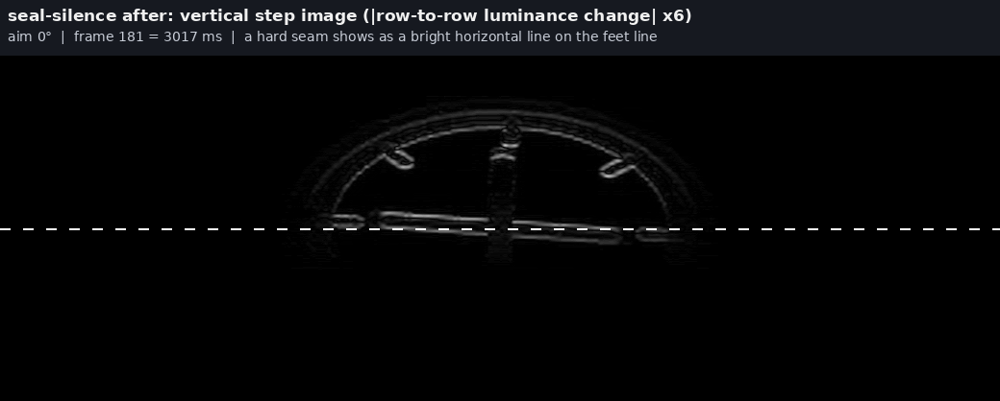

## seal-silence_after_seam-zoom.png

**Skill:** seal-silence · **Frame time:** 3017 ms (frame 181) · **Aim:** 0°

after (PR #34 81c2e2f): ground-under-glow-back layer only, 4x zoom (yellow dashes = feet line); seam removed.

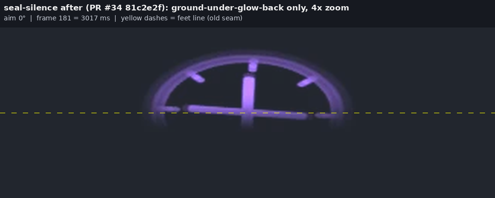

## seal-silence_before_all-layers-zoom.png

**Skill:** seal-silence · **Frame time:** 3017 ms (frame 181) · **Aim:** 0°

before (main cd12ac2): all layers composited, 4x zoom.

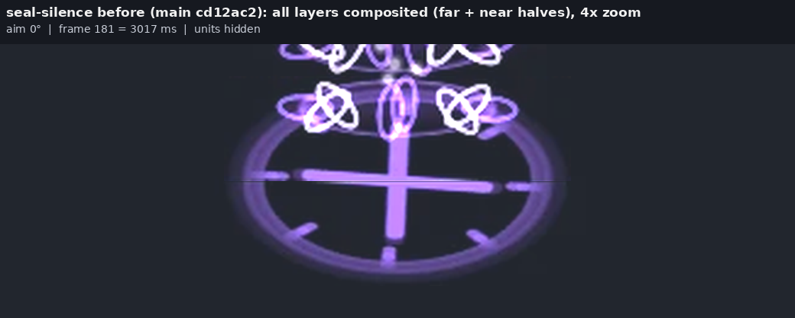

## seal-silence_before_full.png

**Skill:** seal-silence · **Frame time:** 3017 ms (frame 181) · **Aim:** 0°

before (main cd12ac2): full frame.

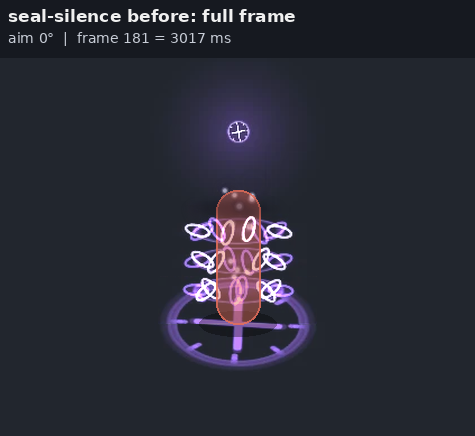

## seal-silence_before_row-step.png

**Skill:** seal-silence · **Frame time:** 3017 ms (frame 181) · **Aim:** 0°

before (main cd12ac2): row-to-row luminance step image (a seam shows as a bright line).

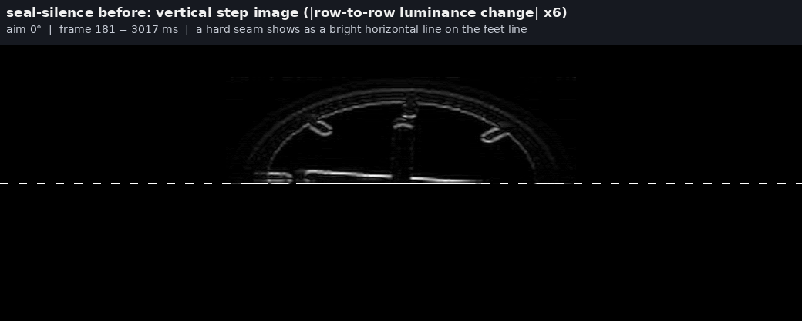

## seal-silence_before_seam-zoom.png

**Skill:** seal-silence · **Frame time:** 3017 ms (frame 181) · **Aim:** 0°

before (main cd12ac2): ground-under-glow-back layer only, 4x zoom (yellow dashes = feet line).

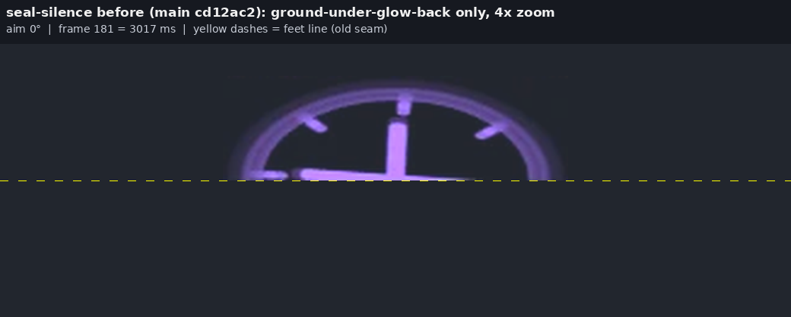

## kim-golden-bell: third blocked hit shatters the bell

Before = factory `main`; after = the Golden Bell shatter PR. The baker casts with one attacker, so on `main` only one
projectile fired, the bell rang once and never broke. After: three blocked attacks (ring, ring + cracks, shatter).
Desktop preset, aim 0°.

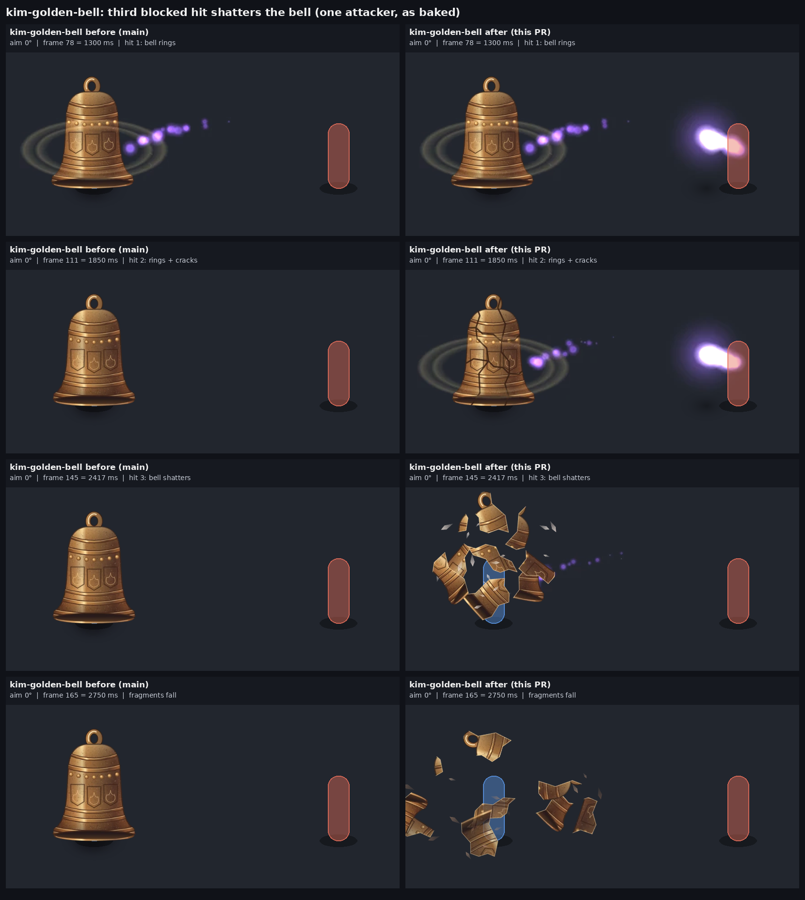

| Frame | Before (main) | After (this PR) |
|---|---|---|
| 1300 ms, aim 0°, hit 1: bell rings | 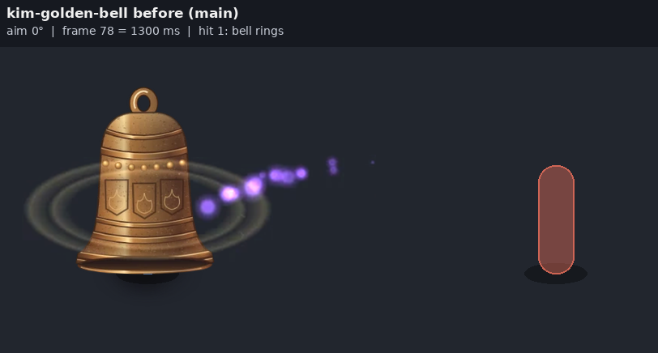 | 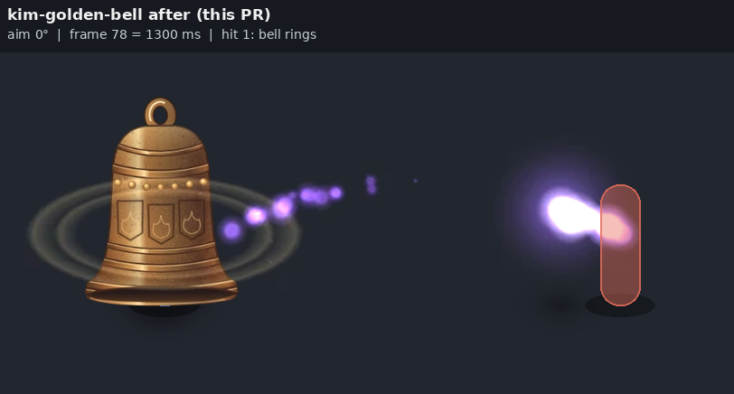 |
| 1850 ms, aim 0°, hit 2: rings, crack overlay appears |  | 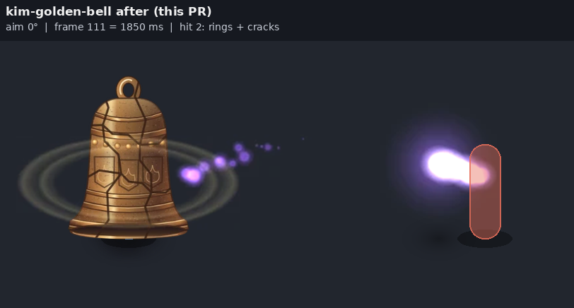 |
| 2417 ms, aim 0°, hit 3: bell shatters into fragments | 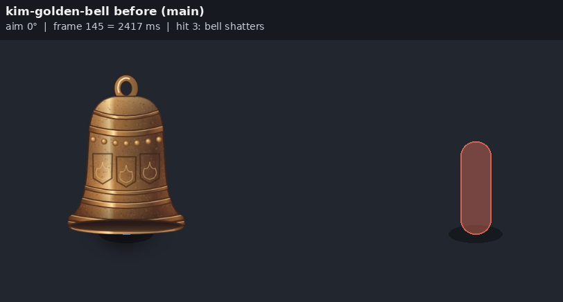 | 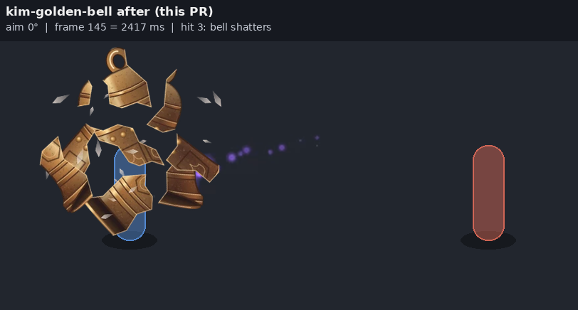 |
| 2750 ms, aim 0°, fragments fall and bounce | 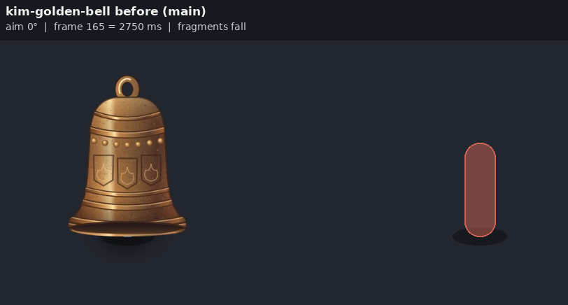 | 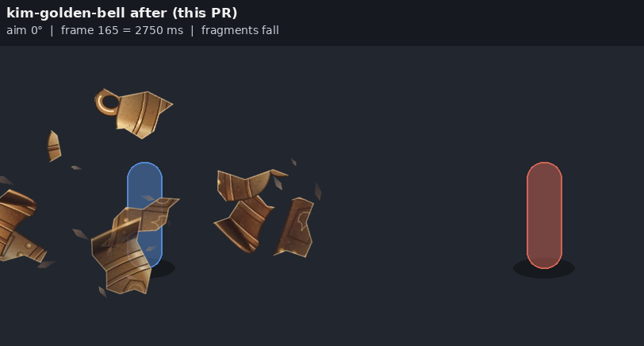 |
